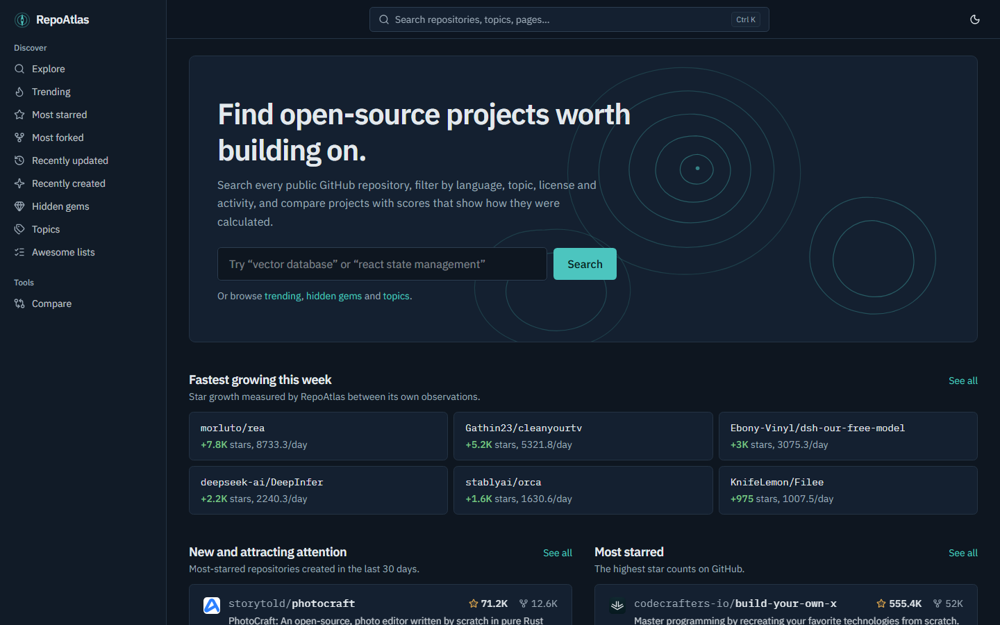
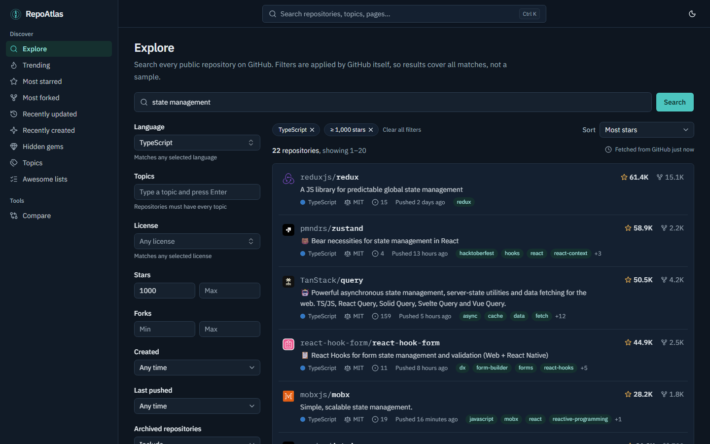
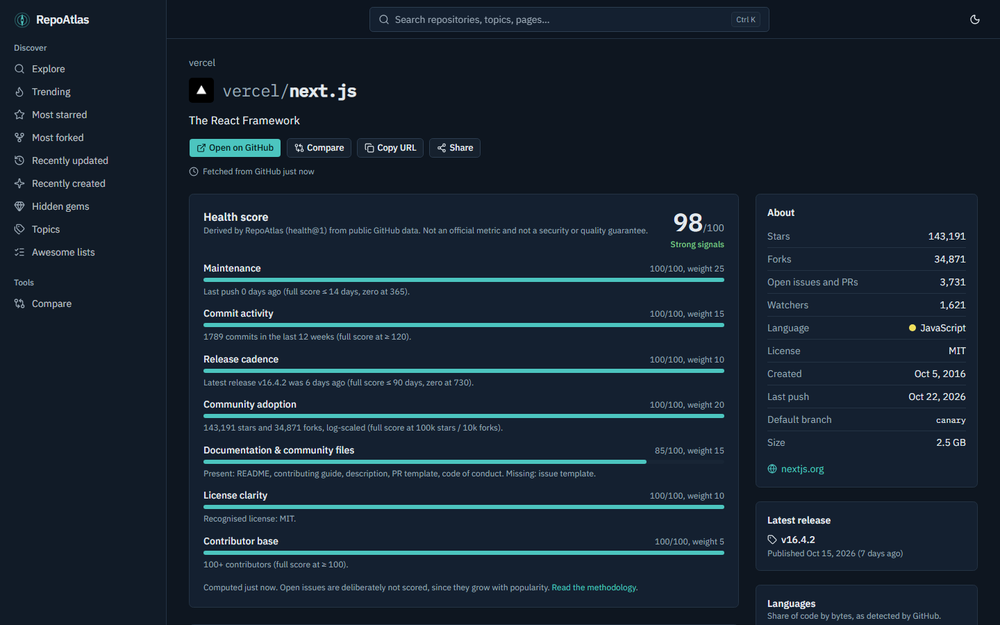
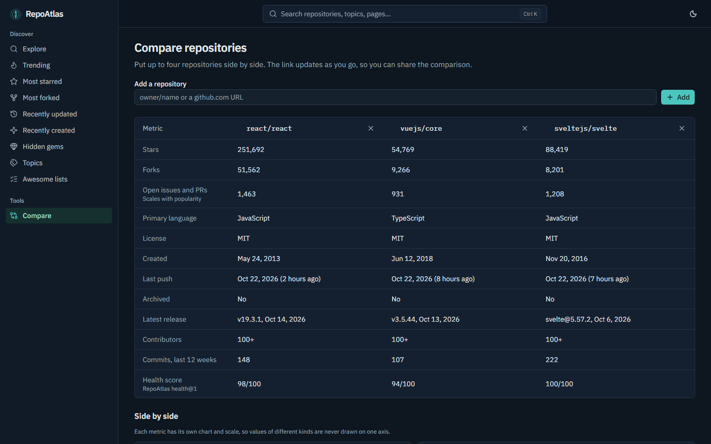
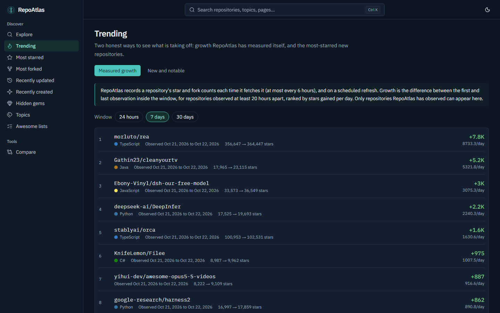
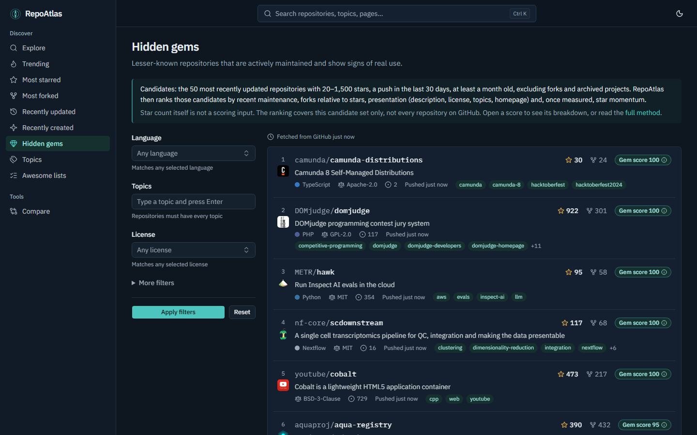
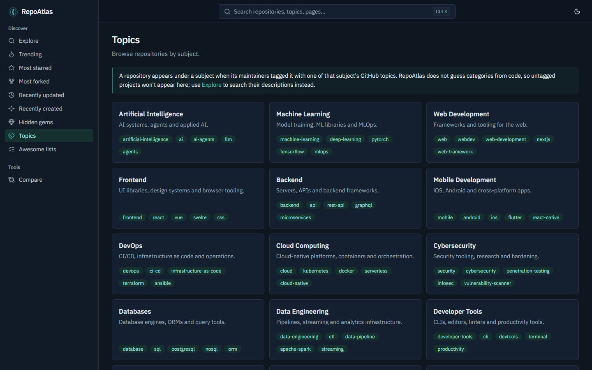
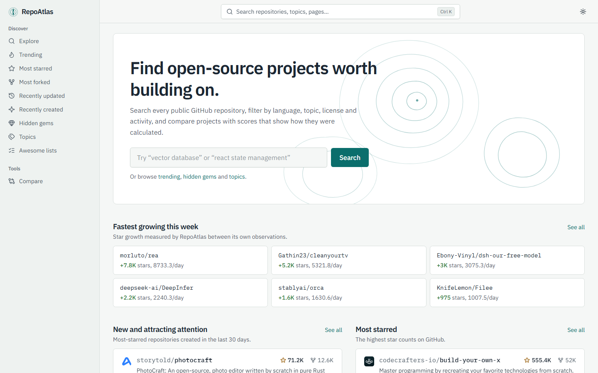

# RepoAtlas

Find open-source repositories worth building on. RepoAtlas searches every public GitHub
repository with advanced filters, ranks them with transparent, versioned scores, and lets you
compare, save and watch projects.



▶️ **[Watch the demo video](docs/media/repoatlas-demo.mp4)** (79 s walkthrough: home, explore, repository page, compare, trending, hidden gems, topics)

- **Explore** — keyword search plus filters for language, topics, license, stars, forks, size,
  creation date, last push, archived/fork status, owner and good-first-issues. Every filter is
  applied by GitHub across all matches; the exact query sent to GitHub is shown under the results.
- **Discovery** — Most starred, Most forked, Recently updated, Recently created, Trending
  (measured growth + new & notable), Hidden gems, Topics and Awesome lists.
- **Repository pages** — metadata, latest release, languages, contributors, weekly commit
  activity, a sanitized README, star history recorded by RepoAtlas, related repositories and a
  documented **health score**.
- **Compare** — up to four repositories side by side, with small-multiple charts and a shareable URL.
- **Accounts** (GitHub sign-in) — saved repositories with notes, collections (private by
  default, link sharing optional, Markdown/JSON export), saved searches, watches with in-app
  alerts, data export and account deletion.
- **AI search** (optional) — describe what you need in plain English; Claude proposes filters,
  you review them, and the regular search runs.

Nothing is fabricated: metrics come from the GitHub API or from observations RepoAtlas recorded,
and every page says when its data was fetched. See [docs/RANKING.md](docs/RANKING.md) and the
in-app *How rankings work* page.

## Screenshots

| Explore with filters | Repository page & health score |
| --- | --- |
|  |  |
| **Compare repositories** | **Trending (measured growth)** |
|  |  |
| **Hidden gems** | **Topics** |
|  |  |

<details>
<summary>Light theme</summary>



</details>

## Stack

Next.js 16 (App Router, Cache Components) · React 19 · TypeScript (strict) · Tailwind CSS 4 ·
shadcn/ui · TanStack Query · Zod · Recharts · PostgreSQL 17 ·
Prisma 7 · Better Auth (GitHub OAuth) · Anthropic SDK · Vitest · Testing Library · Playwright · MSW.

## Quick start (local)

Prerequisites: Node.js 22+ (24 recommended), pnpm 10+, Docker.

```bash
pnpm install                # also generates the Prisma client
cp .env.example .env.local  # then edit values (see below)
pnpm db:up                  # PostgreSQL on localhost:5433 via Docker Compose
pnpm db:migrate             # apply migrations
pnpm dev                    # http://localhost:3000
```

Exploring works with only `DATABASE_URL` and `APP_URL` set. For usable GitHub limits set
`GITHUB_TOKEN`; for accounts set the auth variables.

## Environment variables

| Variable | Required | Purpose |
| --- | --- | --- |
| `DATABASE_URL` | yes | PostgreSQL connection string |
| `APP_URL` | yes | Public base URL, e.g. `http://localhost:3000` |
| `GITHUB_TOKEN` | recommended | Server-side token for public data. A fine-grained PAT with *Public repositories (read-only)* is enough. Without it GitHub allows 10 searches/min and 60 other requests/hour per server IP. |
| `AUTH_SECRET` | for accounts | Random string, 32+ characters |
| `GITHUB_CLIENT_ID` / `GITHUB_CLIENT_SECRET` | for accounts | GitHub OAuth App credentials |
| `CRON_SECRET` | for scheduled jobs | Bearer secret for `/api/cron/*` |
| `ANTHROPIC_API_KEY` | for AI search | Enables natural-language search |

Optional integrations switch themselves off when their variables are missing; the `/status`
page shows what is configured. Secrets are server-only (none use the `NEXT_PUBLIC_` prefix).

### GitHub OAuth setup

1. GitHub → Settings → Developer settings → **OAuth Apps** → New OAuth App.
2. Homepage URL: your `APP_URL`. Authorization callback URL: `{APP_URL}/api/auth/callback/github`.
3. Copy the client ID and generate a client secret into `.env.local`.

RepoAtlas requests only `read:user` and `user:email`. Users' OAuth tokens are stored encrypted
and are never used for GitHub API calls; public data always uses the server's `GITHUB_TOKEN`.

## Scripts

| Command | What it does |
| --- | --- |
| `pnpm dev` | Development server |
| `pnpm build` / `pnpm start` | Production build / server |
| `pnpm lint` · `pnpm typecheck` | ESLint · TypeScript |
| `pnpm test` | Unit, integration (uses `repoatlas_test` database) and component tests |
| `pnpm test:e2e` | Playwright against a production build + mock GitHub API (run `pnpm build` first) |
| `pnpm check` | lint + typecheck + tests + build |
| `pnpm db:up` · `db:migrate` · `db:deploy` · `db:studio` | Database helpers |

## Documentation

- [Product requirements](docs/PRD.md) · [Roadmap](docs/ROADMAP.md)
- [Architecture](docs/ARCHITECTURE.md) · [Database](docs/DATABASE.md) · [API](docs/API.md)
- [Search](docs/SEARCH.md) · [Ranking & scores](docs/RANKING.md)
- [Security](docs/SECURITY.md) · [Deployment](docs/DEPLOYMENT.md) · [Testing](docs/TESTING.md)

## Known limitations

- GitHub search returns at most 1,000 results per query and allows 30 searches/minute with a token.
- Contributor counts, release dates and commit activity are not searchable on GitHub; they appear
  on repository and comparison pages only.
- Trending/growth exists only for repositories RepoAtlas has observed at least twice, 20+ hours
  apart. History starts when an instance first fetches a repository.
- Alerts are checked every few hours by a scheduled job; they are not real-time and need
  `CRON_SECRET` plus a scheduler.
- Pages that resolve to "not found" after streaming has begun return HTTP 200 with a `noindex`
  not-found page (a streaming limitation); API routes return proper 404s.

## Troubleshooting

- **"GitHub's rate limit was reached"** — set `GITHUB_TOKEN`; check `/status` for remaining quota.
- **`Can't reach database server`** — `pnpm db:up`, and check `DATABASE_URL` uses port 5433 locally.
- **Sign-in button missing** — all three auth variables must be set; restart the server.
- **Prisma client errors after pulling** — `pnpm db:generate` then `pnpm db:migrate`.
